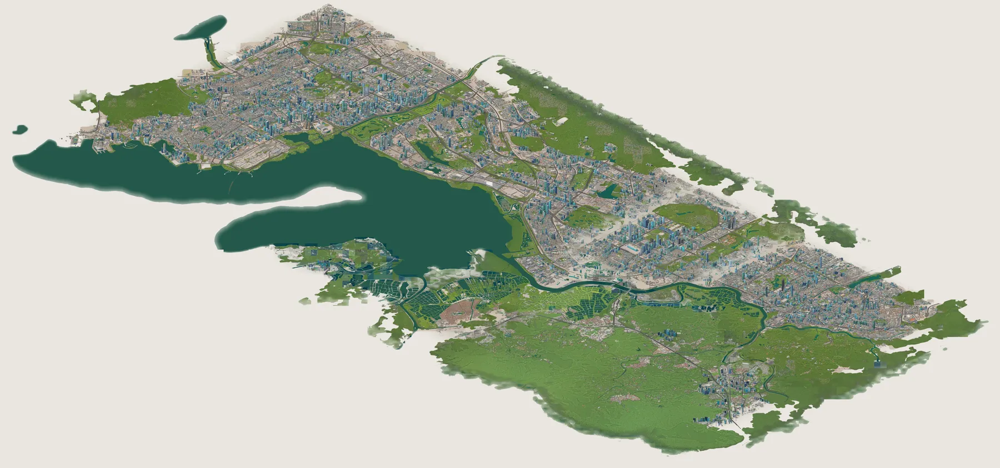

# Tiny Shenzhen

[](https://github.com/sponsors/vincentkoc)
[](LICENSE)

An isometric pixel-art map of Shenzhen you can pan and zoom, from Shekou to Luohu Port.
It is built from open data and drawn in a fine, naturalistic miniature style inspired by
maps such as Pixel Singapore.



Tiny Shenzhen is adapted from [nihey/tinyworlds](https://github.com/nihey/tinyworlds) (MIT,
© 2026 Nihey Takizawa). It uses the same pipeline and viewer, with a Shenzhen city
definition and a Shenzhen style. Nothing is drawn by hand.

## Features

- **Procedural map from open data.** Building footprints and heights, streets, parks, water
  and trees go in, and a pyramid of 512-px pixel-art tiles comes out. No API keys needed.
- **A Shenzhen look.** Warm-grey concrete, teal and sky-blue glass with fine window grids,
  terracotta low roofs, pastel mid-rises, dense urban villages, palms and rounded canopies.
- **Curated landmarks.** Ping An Finance Centre, KK100, China Resources Headquarters, Shun
  Hing Square, the Civic Center, the Stock Exchange, Window of the World and Shenzhen Bay
  Park are searchable, and the towers get their own materials, tapers and heights.
- **Optional restyle.** The live map is the procedural render redrawn with an image model,
  checked against real land and water, then cleaned up with local polish passes. Settings
  switches between the restyled and procedural layers.

## Districts

| City id | Covers | In the viewer |
| --- | --- | --- |
| `tinysz` | About 2 km around the Civic Center: Ping An Finance Centre, Lianhuashan Park, the Futian CBD. Quick to fetch and render. | yes |
| `tinysz-core` | Nanshan, Futian and Luohu as one strip. The default world. | yes |
| `tinysz-nanshan` | Shekou, Houhai, the Science Park and OCT. | rendered for the restyle |
| `tinysz-luohu` | Caiwuwei, Dongmen and Luohu Port. | rendered for the restyle |
| `tinysz-full` | The wider urban core (lat 22.45–22.75, lon 113.80–114.30). A long download and render. | pipeline only |

The city definitions are in `tinyworlds-pipeline/src/cities/tinysz.ts`, and the style is
`SHENZHEN` in `tinyworlds-pipeline/src/scene/styles.ts`.

## Quick start

You need Node 22+ and npm.

```bash
# 1. Make the Futian test box: fetch, scene, render and index
cd tinyworlds-pipeline
npm install
npm run all -- --city tinysz

# 2. View it at http://localhost:3000
cd ../tinyworlds-frontend
npm install
NEXT_PUBLIC_WORLD=tinysz npm run dev
```

`./dev.sh` runs the viewer and a pipeline shell side by side in tmux. Without
`NEXT_PUBLIC_WORLD`, the viewer opens `tinysz-core`, which needs either the restyle below or
a procedural `npm run all -- --city tinysz-core`.

Other pipeline commands, run from `tinyworlds-pipeline/`:

```bash
npm run fetch -- --city tinysz                              # download only
npm run cli -- --city tinysz scene                          # rebuild the scene from fetched data
npm run render -- --city tinysz                             # render tiles
npm run cli -- --city tinysz preview --at 114.0683,22.5455  # one PNG around a point
npm run cli -- --city tinysz card                           # share card
npm test
```

## Restyle pipeline

The restyled map comes from four scripts in [`lora/`](lora/):

```text
render_full.mjs ──► restyle_map.py ──► water_constrain.py ──► slice_frontend.py ──► viewer
```

1. `render_full.mjs` renders a district as procedural chunks.
2. `restyle_map.py` redraws them in overlapping 1024-px windows with an image model. This
   is the only step that calls an API. It sends only our own renders.
3. `water_constrain.py` puts the real land and water back wherever the model invented a
   river or paved over the bay.
4. `slice_frontend.py` slices the districts into one tile pyramid, then runs free,
   idempotent polish passes:

| Pass | Fixes |
| --- | --- |
| `--polish-vignette` | Hard map edge: one smooth fade to the viewer's beige |
| `--polish-water --polish-forest --polish-flats` | Tile steps in the bay, gray-washed land and featureless flats near the edge |
| `--polish-fogline` | Dashed roads and straight cut-offs trailing into the fog |
| `--polish-mint --polish-spots FILE` | Mint forest rims, plus a short list of one-off fixes |

Full commands are in [docs/pipeline.md](docs/pipeline.md), and each pass is described in
[docs/polish-passes.md](docs/polish-passes.md). [`lora/README.md`](lora/README.md) covers
training an image-edit LoRA on our own procedural and restyled pairs.

The look is described in words. No third-party map images are sent to an API, used for
training, or shipped.

## Data

- [OpenStreetMap](https://www.openstreetmap.org/copyright) for streets, parks, water,
  landmarks, and heights where they are tagged.
- [Overture Maps](https://overturemaps.org/) buildings, which merge OSM with the
  [East Asian Buildings](https://doi.org/10.5281/zenodo.8174931) dataset. Read from a public
  bucket, no key needed.
- [3D-GloBFP](https://doi.org/10.1038/s41597-024-03917-6) (Che et al., 2024) for missing
  footprints and per-building heights.
- [CNBH-10m](https://doi.org/10.5281/zenodo.7923866) (Wu et al., 2023), a 10 m height raster
  for China, for the heights left over.

Heights come from OSM height or floors first, then 3D-GloBFP, then CNBH, then a small
fallback. Raw extracts and generated tiles (`tinyworlds-pipeline/data/`,
`tinyworlds-frontend/public/data/`) are not committed; the commands above rebuild them.

## Layout

| Path | What |
| --- | --- |
| `tinyworlds-pipeline/` | TypeScript CLI: fetches data, builds the scene, renders and indexes tiles |
| `tinyworlds-frontend/` | Next.js static site: the map viewer |
| `lora/` | Restyle, water constraint, slicing and polish scripts, plus LoRA training |
| `docs/` | Pipeline guide, polish-pass reference and the README screenshot |
| `docs/superpowers/` | Design specs and plans inherited from upstream tinyworlds |

The upstream tinyworlds cities are still in the pipeline and viewer. The upstream API,
videos, deploy scripts and workflows are not included.

## License and credits

Code is [MIT](LICENSE): © 2026 Nihey Takizawa for tinyworlds, and © 2026 Vincent Koc for the
Tiny Shenzhen changes.

Map data © [OpenStreetMap contributors](https://www.openstreetmap.org/copyright) (ODbL) and
the [Overture Maps Foundation](https://overturemaps.org/). 3D-GloBFP (Che, Y., Li, X., Liu, X.,
et al., 2024), CNBH-10m (Wu, W., et al., 2023) and East Asian Buildings are CC BY 4.0. The
rendered tiles carry these attribution requirements.

The idea of a city redrawn tile by tile as isometric pixel art comes from
[tinyrj](https://tinyrj.com/) and isometric.nyc, as tinyworlds credits. The restyled look is
inspired by Pixel Singapore. This is an independent work and uses none of its images.

If you enjoy the map, you can [sponsor its development](https://github.com/sponsors/vincentkoc).
