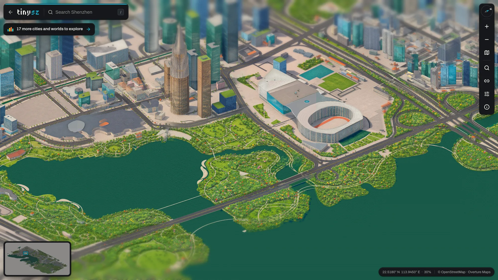
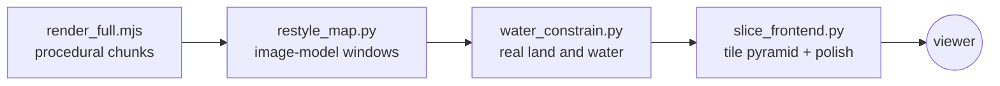

<div align="center">

# Tiny Shenzhen

**An isometric pixel-art map of Shenzhen you can pan and zoom, from Shekou to Luohu Port.**

Built from open data. Drawn in a fine miniature style inspired by Pixel Singapore.

[](LICENSE)
[](https://github.com/sponsors/vincentkoc)
[](https://github.com/vincentkoc/tinyshenzhen/stargazers)


[Features](#features) · [Quick start](#quick-start) · [Pipeline](#pipeline) · [Credits](#credits)

</div>

<br>



<br>

Tiny Shenzhen is adapted from [nihey/tinyworlds](https://github.com/nihey/tinyworlds). It keeps the
same pipeline and viewer, and adds a Shenzhen city definition and style. Nothing is drawn by hand.

## Features

- 🗺️ **Procedural map from open data.** Footprints, heights, streets, parks, water and trees go
  in. A pyramid of 512-px pixel-art tiles comes out. No API keys needed.
- 🏙️ **A Shenzhen look.** Warm-grey concrete, teal glass with fine window grids, terracotta
  roofs, pastel mid-rises, dense urban villages and palms.
- 📍 **Searchable landmarks.** Ping An Finance Centre, KK100, China Resources Headquarters,
  Shun Hing Square, the Civic Center, Window of the World and Shenzhen Bay Park. The towers get
  their own materials, tapers and heights.
- 🎨 **Optional restyle.** The live map is the procedural render redrawn by an image model,
  checked against real land and water, then cleaned up locally.
- 🔀 **Two layers.** Settings switches between the restyled and procedural tiles.

## Districts

| City id | Covers | Viewer |
| --- | --- | :---: |
| `tinysz-core` | Nanshan, Futian and Luohu as one strip. The default world. | ✅ |
| `tinysz` | About 2 km around the Civic Center and the Futian CBD. Quick to build. | ✅ |
| `tinysz-nanshan` | Shekou, Houhai, the Science Park and OCT. | restyle input |
| `tinysz-luohu` | Caiwuwei, Dongmen and Luohu Port. | restyle input |
| `tinysz-full` | The wider urban core. A long download and render. | pipeline only |

## Quick start

Requires Node 22+ and npm.

```bash
# 1. Build the Futian test box (fetch, scene, render, index)
cd tinyworlds-pipeline && npm install
npm run all -- --city tinysz

# 2. Open it at http://localhost:3000
cd ../tinyworlds-frontend && npm install
NEXT_PUBLIC_WORLD=tinysz npm run dev
```

> [!TIP]
> `./dev.sh` runs the viewer and a pipeline shell side by side in tmux.
> Without `NEXT_PUBLIC_WORLD`, the viewer opens `tinysz-core`. Build it with the restyle
> pipeline below, or procedurally with `npm run all -- --city tinysz-core`.

## Pipeline

The live map comes from four scripts in [`lora/`](lora/). Only the restyle step calls an image
model, and it only sends our own renders.



After slicing, free local polish passes clean up the map edge:

| Pass | Fixes |
| --- | --- |
| `--polish-vignette` | Hard map edge, faded smoothly to the viewer's beige |
| `--polish-water --polish-forest --polish-flats` | Tile steps in the bay, gray-washed land, flat patches |
| `--polish-fogline` | Dashed roads and straight cut-offs trailing into the fog |
| `--polish-mint --polish-spots FILE` | Mint forest rims, plus listed one-off fixes |

📖 Full commands: [docs/pipeline.md](docs/pipeline.md) · Each pass: [docs/polish-passes.md](docs/polish-passes.md) · LoRA training: [lora/README.md](lora/README.md)

<details>
<summary><b>More pipeline commands</b></summary>

<br>

Run from `tinyworlds-pipeline/`:

```bash
npm run fetch -- --city tinysz                              # download only
npm run cli -- --city tinysz scene                          # rebuild the scene from fetched data
npm run render -- --city tinysz                             # render tiles
npm run cli -- --city tinysz preview --at 114.0683,22.5455  # one PNG around a point
npm run cli -- --city tinysz card                           # share card
npm test
```

City definitions live in `tinyworlds-pipeline/src/cities/tinysz.ts`. The style is `SHENZHEN` in
`tinyworlds-pipeline/src/scene/styles.ts`.

</details>

<details>
<summary><b>Project layout</b></summary>

<br>

| Path | What |
| --- | --- |
| `tinyworlds-pipeline/` | TypeScript CLI: fetches data, builds the scene, renders and indexes tiles |
| `tinyworlds-frontend/` | Next.js static site: the map viewer |
| `lora/` | Restyle, water, slicing and polish scripts, plus LoRA training |
| `docs/` | Pipeline guide, polish-pass reference, README screenshot |
| `docs/superpowers/` | Design specs and plans inherited from upstream tinyworlds |

The upstream tinyworlds cities are still included. The upstream API, videos, deploy scripts and
workflows are not. Raw extracts and generated tiles are not committed; the commands above
rebuild them.

</details>

## Data

| Source | Used for |
| --- | --- |
| [OpenStreetMap](https://www.openstreetmap.org/copyright) | Streets, parks, water, landmarks, tagged heights |
| [Overture Maps](https://overturemaps.org/) | Buildings, merged with [East Asian Buildings](https://doi.org/10.5281/zenodo.8174931) |
| [3D-GloBFP](https://doi.org/10.1038/s41597-024-03917-6) | Missing footprints and per-building heights |
| [CNBH-10m](https://doi.org/10.5281/zenodo.7923866) | Remaining heights, from a 10 m raster |

Heights come from OSM first, then 3D-GloBFP, then CNBH, then a small fallback.

## Credits

- **Code:** [MIT](LICENSE). © 2026 Nihey Takizawa for [tinyworlds](https://github.com/nihey/tinyworlds),
  © 2026 Vincent Koc for the Tiny Shenzhen changes.
- **Map data:** © [OpenStreetMap contributors](https://www.openstreetmap.org/copyright) (ODbL) and the
  [Overture Maps Foundation](https://overturemaps.org/). 3D-GloBFP (Che et al., 2024), CNBH-10m
  (Wu et al., 2023) and East Asian Buildings are CC BY 4.0. Rendered tiles carry these attributions.
- **Inspiration:** the tile-by-tile isometric city idea comes from [tinyrj](https://tinyrj.com/) and
  isometric.nyc, as tinyworlds credits. The restyled look is inspired by Pixel Singapore. This is an
  independent work and uses none of its images.

<br>

<div align="center">

**Enjoying the map?** [Sponsor its development](https://github.com/sponsors/vincentkoc) 💖

</div>
